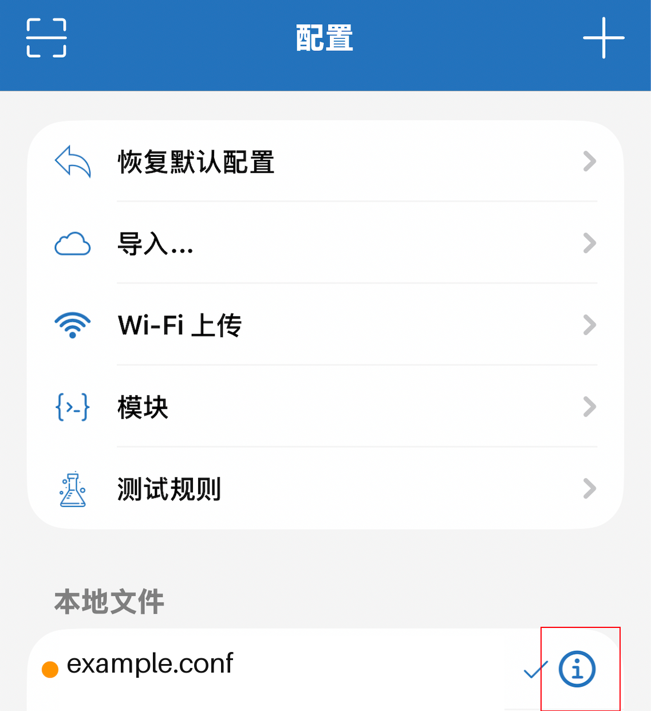
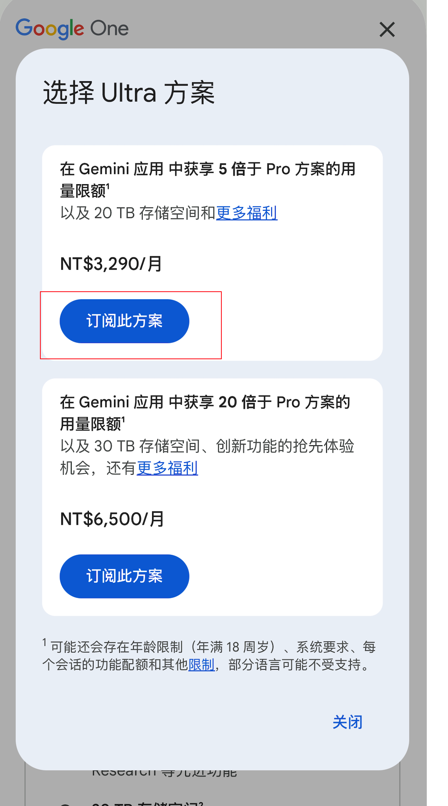

# g1-acq

[](https://t.me/muihbb)

> 💬 **AI Deals Group**: https://t.me/muihbb — discussing AI subscription deals and savings

Google One (iOS) subscription-page SKU mapping module for **Shadowrocket** and **Anywhere**.

This repository tracks the upstream module [crhywun/g1-acq](https://github.com/crhywun/g1-acq) (`v7.11.0`) and adds **Anywhere and ProxyPin ports** of the same feature set. Upstream is the canonical Shadowrocket release; this repo mirrors it so the ports and the Shadowrocket scripts live in one place.

**What v7.11 does:**

- **Configurable SKU mappings with local editor**: the report page covers four preset templates (`ultra-75p`, `tr-ultra-30tb`, `pro-12months-90p`, `pro-1yuan`) applied with one tap, plus manual rules (exact or prefix match, enable/disable, 30-rule cap), all saved on-device under `g1.sku.mappings.v1`
- **Default mode `discount75`**: 20TB / 30TB → their 3-month 75p offers (75% off), original iOS 2TB → `g1.2tb.ai.12months_ip_90p`
- **No fallback tiers**: each enabled rule is applied once; a target already present in the response does not change execution
- **Passive SKU collection**: every `g1.*` / `com.google.one.*` / `com.google.gemini.*` ID appearing in `one.google.com` responses is collected (dedup, counts, up to 300 IDs), plus diagnostics for the last 10 responses
- **Local report page**: open `https://one.google.com/g1-sku-report` in Safari to view collected IDs, edit mappings and export JSON

> Only product-ID strings in the response text are rewritten. Whether an order can actually be placed, and the price and benefits charged, are subject to the App Store checkout panel and the actual state of your Google One account. Response IDs prove the page carries the string, not that the store catalogs the product.

---

## Module addresses

**Shadowrocket — recommended: install the upstream release directly:**

```
https://cdn.jsdelivr.net/gh/crhywun/g1-acq@v7.11.0/g1-acq-ultra-discount.sgmodule
```

**Shadowrocket — mirror from this repo (identical scripts, same `v7.11.0` pin):**

```
https://cdn.jsdelivr.net/gh/mkrfsbri/g1-acq@v7.11.0/g1-acq-ultra-discount.sgmodule
```

**Anywhere (module, this repo's port):**

```
https://raw.githubusercontent.com/mkrfsbri/g1-acq/main/g1-acq.amod
```

Script addresses (already referenced inside the modules, no separate entry needed):

```
https://cdn.jsdelivr.net/gh/mkrfsbri/g1-acq@v7.11.0/g1-acq-discount.js
https://cdn.jsdelivr.net/gh/mkrfsbri/g1-acq@v7.11.0/g1-sku-report-discount.js
https://cdn.jsdelivr.net/gh/mkrfsbri/g1-acq@main/g1-acq-anywhere.js
```

## Mapping table

Upstream v7.11 ships three built-in rules (mode `discount75`) and lets you change them on-device:

| Original iOS IAP ID | Replaced with | Note |
|---|---|---|
| `g1.ios.2tb.*` (any complete SKU with this prefix) | `g1.2tb.ai.12months_ip_90p` | Original 2TB → 12-month Pro 90p offer (no `.acq` suffix) |
| `g1.ios.20tb.m.v2` | `g1.20tb.3months_ip_75p.acq` | 20TB monthly → 3-month 75p offer (75% off) |
| `g1.ios.30tb.ai.pro.m` | `g1.ai.ultra.3months_ip_75p.acq` | 30TB AI Pro monthly → AI Ultra 3-month 75p offer |

Preset templates available in the report page: `ultra-75p` (the default 75p pair), `tr-ultra-30tb` (Turkey price track, uses the older `g1.ios.30tb.m` ID), `pro-12months-90p` (2TB prefix rule), `pro-1yuan` (Pro tier one-yuan style offer, v7.11). Applying a preset merges it into your rules and saves it locally; the next `/ai?` response uses the new rules, so reload the plan page afterwards.

There are no fallback tiers in v7.11: every enabled rule fires once, and whether the target already appears in the response does not change execution. `75p` means 75% off (pay 25%), `90p` means 90% off (pay 10%).

Promo tier IDs are limited-time promotional products; their names and tiers change with Google's campaigns. The collection log lists every ID actually present in the current response — add or edit mapping rules based on that log.

## Installation (Shadowrocket)

The entry to the HTTPS decryption setting: config page → tap the **(i)** icon to the right of the active config → find **HTTPS Decryption** in the config edit page.



1. Keep the VPN on
2. Settings → **HTTPS Decryption** (MITM) → master switch on → certificate: generate and install → complete the two iOS steps:
   - Settings → General → VPN & Device Management → install the Shadowrocket profile
   - Settings → General → About → **Certificate Trust Settings** → enable trust for the Shadowrocket root certificate (skipping this makes decryption ineffective)
3. In the HTTPS Decryption hostname list, confirm `one.google.com` is present (added automatically when the module is on)
4. Config → Modules → `+` in the top right → paste the module address above → install
5. Confirm the module switch is lit, then long-press and reconnect once

Full install and on-device verification guide: [docs/pro-annual-test.md](docs/pro-annual-test.md).

## Installation (Anywhere, free and open source)

Requires iOS 18+.

1. Install [Anywhere](https://apps.apple.com/id/app/anywhere-proxy/id6758235178)
2. In the app, generate and install the root CA, then enable trust: iOS Settings → General → About → **Certificate Trust Settings** → enable the Anywhere root CA
3. Enable the app's MITM master switch
4. Modules → import the `.amod` file, or subscribe to:
   ```
   https://raw.githubusercontent.com/mkrfsbri/g1-acq/main/g1-acq.amod
   ```
5. Anywhere refuses to connect with zero configurations: import the blank direct profile first:
   ```
   https://raw.githubusercontent.com/mkrfsbri/g1-acq/main/anywhere-direct.yaml
   ```
6. Toggle the module on, connect the VPN
7. Google App → Google One management → subscription page → the 2TB / 20TB / 30TB plans
8. Verify: search the log for `[g1-acq]`; `v7.11 rewrote N occurrence(s)` means it is working

Anywhere port limits (vs Shadowrocket): no persistent storage and no local report page — the collector runs in log mode only, and there is no `g1-sku-report` page. One deliberate deviation from upstream: the 2TB → 12-month 90p rewrite only fires when a 2TB 90p offer appears in your region's response; where it does not (e.g. region ID), the real 2TB plans stay untouched and purchasable. Everything else (75p default and 2TB target, ID logging) matches upstream v7.11 defaults; the on-device mapping editor is Shadowrocket-only, so the port keeps the built-in rules.

## Installation (ProxyPin, free and open source)

ProxyPin runs the same logic from a JS script instead of a module. It captures HTTPS, supports a JS `onResponse(context, request, response)` hook, and persists files on-device.

1. Install [ProxyPin](https://apps.apple.com/id/app/proxypin-tangkap-trafik/id6450932949), start the VPN capture, install and trust its CA certificate (iOS Settings → General → About → **Certificate Trust Settings**)
2. Add `one.google.com` to the capture/rewrite domain filter
3. Script → new script → paste `g1-acq-proxypin.js` from this repo, then enable it
4. Google App → Google One management → open a plan page → check the ProxyPin script console for `[g1-acq] v7.11`

The script keeps the same mapping and the same catalog guard as the Anywhere port. ProxyPin also exposes a File API in the app support directory if you want the collected IDs written to disk between sessions; the script logs only.

## Scope of effect

- URL match (Shadowrocket): `^https://one\.google\.com/` for collection, `^https://one\.google\.com/ai\?` for rewriting; the local report page intercepts `/g1-sku-report` and never leaves the device
- URL match (Anywhere): `^https://one\.google\.com/ai\?` only
- MITM hostname: `one.google.com`
- QUIC blocking: the Shadowrocket module ships a rule that blocks UDP 443 so the Google App cannot bypass HTTPS decryption over HTTP/3; Anywhere has a built-in QUIC policy, no rule needed

## Usage flow (phone)

1. Open the **Google App** (the colorful G icon) → profile avatar → **Google One management**, and enter the subscription management page (this page's `/ai` response is what the module rewrites)
2. Open the 2TB / Pro plan for the 12-month offer test; open the actual 20TB / 30TB plans to verify the retained mappings
3. In the App Store checkout, verify the product name, period, first charge and renewal amount; benefits are subject to the Google One account state



> Note: the subscription page entered from the standalone Google One app goes through a native API and is outside this module's rewrite scope. Always enter from **Google One management inside the Google App**.

## Verification and troubleshooting

Shadowrocket: Data → Logs → Proxy, search for `g1-acq`:

| Log | Meaning |
|---|---|
| `g1-acq-v7.11-mappings status=... addedCount=N candidates=N occurrences=N saved=yes/no` | Collection status, new IDs kept, deduped candidates, occurrence count, storage result |
| `g1-acq-v7.11-mappings hits=N annualHits=N` | Total rewrites and 2TB/Pro rewrites |
| `source SKU -> target xN` | Per-source rewrite result (no fallback tiers in v7.11) |
| Local report: `https://one.google.com/g1-sku-report` | On-device HTML report, JSON export, `?clear=1` manual reset |

Anywhere: search the log for `g1-acq`:

| Log | Meaning |
|---|---|
| `v7.11 collected N id(s): ...` | Every `g1.*` / `com.google.one.*` / `com.google.gemini.*` ID in the response, deduped with counts |
| `v7.11 rewrote N occurrence(s)` | Replacement executed |
| `2TB target 90p not in region catalog, 2TB rewrite skipped` | Region guard: real regional 2TB plans left purchasable |

After changing mapping tables: `git push`, then clear the Shadowrocket cache once (Data → Clear All Data) and reconnect; jsDelivr caches for a few minutes — purge manually with `https://purge.jsdelivr.net/gh/mkrfsbri/g1-acq@v7.11.0/g1-acq-discount.js`. Anywhere subscribed modules refresh on their own schedule.

## Permissions and safety boundary

- **Traffic visibility**: the scripts match only HTTP responses of `one.google.com`; they can read and rewrite those response bodies. Traffic of any other domain is never read or modified
- **No outbound capability**: the scripts contain no network calls; all output goes to the on-device log / local report only
- **MITM scope**: only the single hostname `one.google.com` is appended; the CA certificate is generated and kept on the user's device and cannot be obtained by the module author
- **System permissions**: no iOS permissions requested (no notification/location/camera prompts); installation happens inside the proxy app only
- **Global side effect**: `[Rule]` blocks all UDP 443 (QUIC), which slows HTTP/3 for every app — a performance side effect with no privacy impact
- **Trust model**: script addresses point at this GitHub repository (or upstream) and the jsDelivr CDN. Installing means trusting the repository owner's future changes to the script (a malicious version could at most obtain cookies and page data of the single domain `one.google.com`; nothing else is reachable), plus the service integrity of GitHub / jsDelivr. The scripts are open source and can be reviewed by anyone; when distributing, replace `@main` with an exact commit hash to lock an immutable version

## Files

| File | Purpose |
|---|---|
| `g1-acq-ultra-discount.sgmodule` | Main Shadowrocket module (v7.11): passive collection, configurable mappings, local report with editor |
| `g1-acq-v7.sgmodule` | Retained older entry (name **G1 ACQ**), same local mapping config |
| `g1-acq-discount.js` / `g1-acq.js` | `g1-acq-v7.11-mappings` response scripts (identical implementations) |
| `g1-sku-report-discount.js` / `g1-sku-report.js` | Local HTML report page, mapping editor, presets, JSON export |
| `lib/mapping-config.js` | Mapping rule model: exact/prefix rules, presets, revision control, 30-rule cap, `com.google.gemini` namespace |
| `tools/build-variants.cjs` | Builds the `-discount` module/script variants from the main files |
| `g1-acq-anywhere.js` | Anywhere port of the rewrite + log-mode collector (`process(ctx)` + `Anywhere.codec` API) |
| `g1-acq-probe.js` / `g1-acq-probe.amod` | Collector-only port: logs every SKU and raw plan field, rewrites nothing. Use it to enumerate a region's real catalog |
| `g1-acq-proxypin.js` | ProxyPin port (`async onResponse(context, request, response)`), same mapping and guards |
| `g1-acq.amod` | Anywhere module (embeds the script above, import and use) |
| `anywhere-direct.yaml` | Blank direct profile so Anywhere can connect without a server |
| `g1-sku-scan.js` / `g1-sku-scan.sgmodule` | Upstream legacy standalone scanner (compat, not needed for the main flow) |
| `g1-pro-annual-test.js` / `g1-pro-annual-test.sgmodule` | Upstream legacy annual-test entry (compat, not needed for the main flow) |
| `docs/TUTORIAL-ID.md` | Panduan pemakaian lengkap dalam Bahasa Indonesia (ProxyPin / Anywhere / Shadowrocket, mapping, troubleshooting) |
| `docs/pro-annual-test.md` | Upstream guide: SKU management, presets, passive collection diagnostics, on-device verification |
| `tests/` | Offline test suites (upstream 189 tests + Anywhere port checks) |

## Offline verification

Node.js 18+, repository root:

```sh
node --test tests/sku-tools.test.cjs tests/mapping-editor.test.cjs && node tests/anywhere-port.test.cjs && node tests/proxypin-port.test.cjs
```

The upstream suites (189 tests) cover complete-ID and prefix matching, mapping CRUD and presets, revision conflicts, the fixed 2TB 12-month candidate, URL scope, zero-match, report compatibility with older record versions, collection dedup and limits, and module script pins. The Anywhere checks cover the ported rewrite and collector against a simulated `Anywhere` API. Test source IDs are synthetic samples, not store-listing or purchase evidence.

## Customization

- Shadowrocket: mappings are edited on-device in the report page (presets, or manual exact/prefix rules); the built-in defaults live in `lib/mapping-config.js`
- Anywhere: edit `SKU_MAP` / `FALLBACK` at the top of `g1-acq-anywhere.js`, then re-embed the base64 into `g1-acq.amod`
- Price rewriting: not implemented; if needed, append a regex replacement of `price_amount_micros` after the replacement loop
- The scripts have no telemetry and no external dependencies
